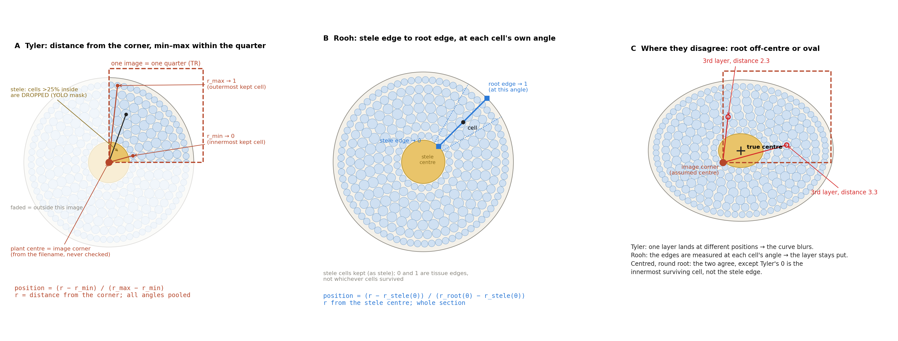

# Cell position: Rooh vs Tyler's maize-cells (2026-11-03)

Schematic on a synthetic root. Redraw with `python draw_cell_position.py`.

## Tyler (github.com/TylerMMitts/maize-cells, used for the 01_Cortex patterning results)

1. **One image is one quarter of the section**, cropped so that the root centre sits in a corner. The quarter tag in the filename (BL/BR/TL/TR) picks that corner, and it is taken as the plant centre without being checked (`util/visualize_cell_centers.py: get_plant_center_from_filename`).
2. **Cell centre** = centroid of the cell mask (`cv2.moments` of its largest contour), found after YOLOv8-seg and the optional SAM or region-growing refinement (`yolo/test_robust.py: extract_cell_data`).
3. **The stele removes cells; it does not position them.** The "exclusion" YOLO model returns the inner part (stele) and the outer part (beyond the root) as one mask. Any cell with more than 25% of its area in that mask is dropped (`config.py: exclusion_overlap_threshold = 25`). Overlapping duplicate cells are also dropped.
4. **r** = straight-line distance from the corner to the cell centre (`measurements/cell_measurements.py`). The angle is recorded but not used.
5. **Position** = (r − r_min) / (r_max − r_min), computed within the quarter with all angles pooled (`measurements/build_feature_table.py`). So 0 is the innermost cell that survived filtering, and 1 is the outermost.

## Rooh

Position = (r − r_stele(θ)) / (r_root(θ) − r_stele(θ)), where:
- r is measured from the stele centre.
- r_stele(θ) and r_root(θ) are the stele and root outlines at the cell's own angle (`pipeline.radial_position`).

So 0 and 1 are tissue edges, not whichever cells survived filtering. It covers the whole section, with damaged arcs excluded.

## Where they differ

- **Off-centre or oval root (panel C):** in Tyler's method one cortical layer is spread across several positions, which blurs the profile. Rooh's edges are taken at each cell's own angle, so a layer stays at one position.
- **Centred, round root:** the two methods agree, except that Tyler's 0 is the innermost surviving cell, not the stele edge. His scale also moves if the stele mask bleeds into the cortex or an edge cell is lost.
- **Tyler needs neither outline**, only the corner and the extreme cells. **Rooh needs both outlines.**

## Decision

Rooh keeps its own position. Tyler's math is to be ported exactly, as extra `tyler_*` columns computed on the same cells:
- distance from the stele centre (standing in for his crop corner),
- min–max over the kept cortex cells,
- cells dropped if they overlap the stele by more than 25%,
- then his bins, spline and features.

The port is accepted only once it reproduces his `feature_table.csv` from his own per-cell tables. Pending.
